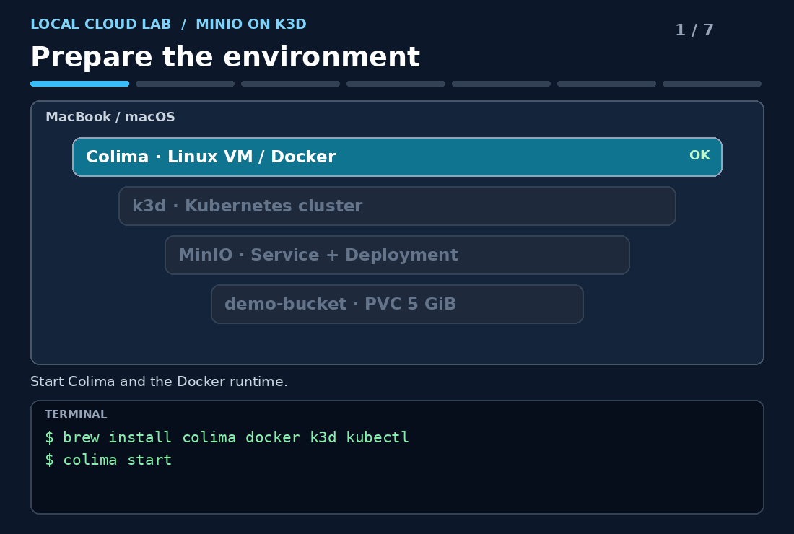

# MinIO on k3d

Run an S3-compatible object store on your laptop in a few minutes: [MinIO](https://min.io) on a local Kubernetes cluster created with [k3d](https://k3d.io).

## 🎬 Interactive Walkthrough

Explore the complete MinIO deployment step by step, with interactive architecture diagrams and copyable Kubernetes commands.

[🚀 Launch Interactive Walkthrough](https://hasan-soh-sahin.github.io/minio-on-k3d/minio-walkthrough.html)



Full walkthrough with explanations: [docs/medium-article.md](docs/medium-article.md).

## What you get

- A single-node k3d cluster called `minio-lab`
- MinIO in namespace `minio`, with data on a 5 Gi persistent volume (survives pod restarts)
- A bucket called `demo-bucket`, created by a one-shot Job
- S3 API on `http://localhost:9000`, web console on `http://localhost:9001`
- Credentials: `minioadmin` / `minioadmin` (local use only)

## Prerequisites

| Tool | Install (macOS) | Tested with |
|---|---|---|
| A Docker runtime (Docker Desktop, Colima or OrbStack) | `brew install colima docker && colima start` | Docker Engine 29.5 on Colima |
| k3d | `brew install k3d` | v5.9.0 (k3s v1.35.5) |
| kubectl | `brew install kubectl` | v1.37.1 |
| curl ≥ 7.75 (for the smoke test) | preinstalled on macOS | 8.7.1 |

Plan for about 1 GB of free RAM and 2 GB of free disk.

## Quick start

```bash
git clone https://github.com/hasan-soh-sahin/minio-on-k3d.git
cd minio-on-k3d

make up          # cluster + MinIO + bucket
make forward     # in a second terminal: localhost:9000 (API), localhost:9001 (console)
make test        # health, bucket check, upload, download, delete
```

Expected output of `make test`:

```
ok    health
ok    bucket demo-bucket exists
ok    upload
ok    download
ok    delete
All good.
```

## Use it

**aws CLI**

```bash
export AWS_ACCESS_KEY_ID=minioadmin AWS_SECRET_ACCESS_KEY=minioadmin AWS_DEFAULT_REGION=us-east-1
aws --endpoint-url http://localhost:9000 s3 cp README.md s3://demo-bucket/
aws --endpoint-url http://localhost:9000 s3 ls s3://demo-bucket/
```

**Python (boto3)**

```python
import boto3

s3 = boto3.client("s3", endpoint_url="http://localhost:9000",
                  aws_access_key_id="minioadmin", aws_secret_access_key="minioadmin",
                  region_name="us-east-1")
s3.put_object(Bucket="demo-bucket", Key="hello.txt", Body=b"hello from python")
print(s3.get_object(Bucket="demo-bucket", Key="hello.txt")["Body"].read().decode())
```

**mc from inside the cluster** (no port-forward needed)

```bash
./scripts/mc.sh ls -r local/demo-bucket
```

**From other pods in the cluster**, use `http://minio.minio.svc.cluster.local:9000`.

## Make targets

| Target | What it does |
|---|---|
| `make up` | Create the cluster, deploy MinIO, wait for the bucket |
| `make forward` | Port-forward 9000 and 9001 to your laptop (keep it running) |
| `make test` | Smoke test through the port-forward |
| `make ls` | List all buckets and objects with `mc` |
| `make down` | Stop the cluster, keep data (`k3d cluster start minio-lab` to resume) |
| `make clean` | Delete the cluster and all data |

## Troubleshooting

| Symptom | Cause and fix |
|---|---|
| `ImagePullBackOff` on `minio/minio` or `minio/mc` | Those Docker Hub images are no longer pullable. This repo uses `cgr.dev/chainguard/minio` and `cgr.dev/chainguard/minio-client`. |
| `curl http://localhost:9000` returns `AccessDenied` | Expected: S3 requests must be signed. Use `--aws-sigv4`, the aws CLI, or an SDK. |
| `connection refused` on localhost:9000 | The port-forward isn't running. Run `make forward`. |
| `input/output error` from Docker | The disk holding your Docker VM is full. Free space, or move the VM to a bigger disk (see the article). |
| Requests reach the wrong MinIO | Another port-forward is already using port 9000. `pkill -f "port-forward svc/minio"` |
| `couldn't attach to pod/mc-...` warning | Harmless: the mc pod finished before kubectl attached; output is still shown. |

## Files

```
k8s/minio.yaml          namespace, secret, PVC, deployment, service, create-bucket job
scripts/mc.sh           run mc commands from a throwaway pod
scripts/smoke-test.sh   end-to-end check from your laptop
docs/medium-article.md  step-by-step tutorial
```

## Not for production

Default credentials, a single replica and no TLS. This setup is for local development and demos only.

## License

MIT
